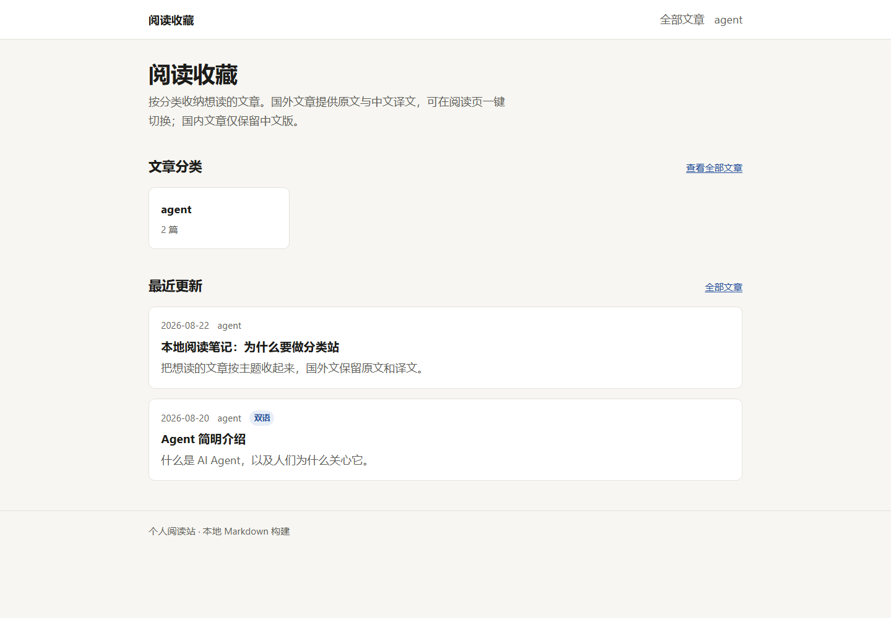
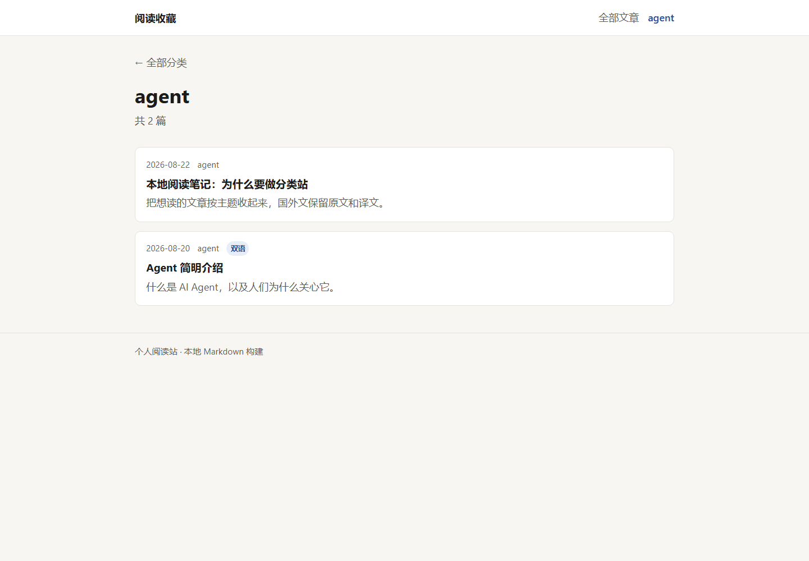
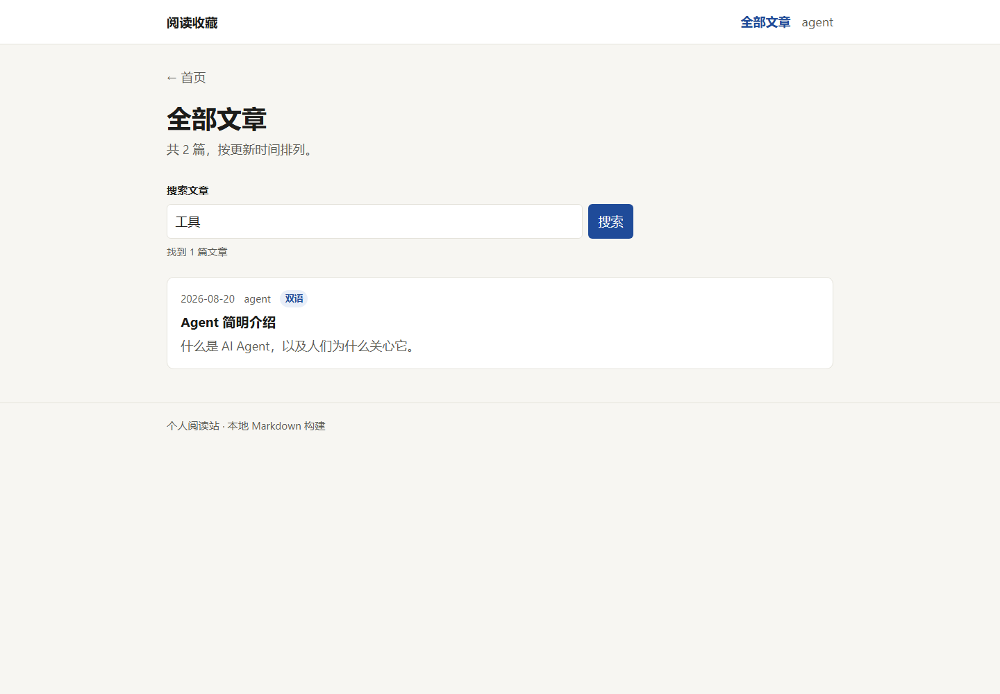
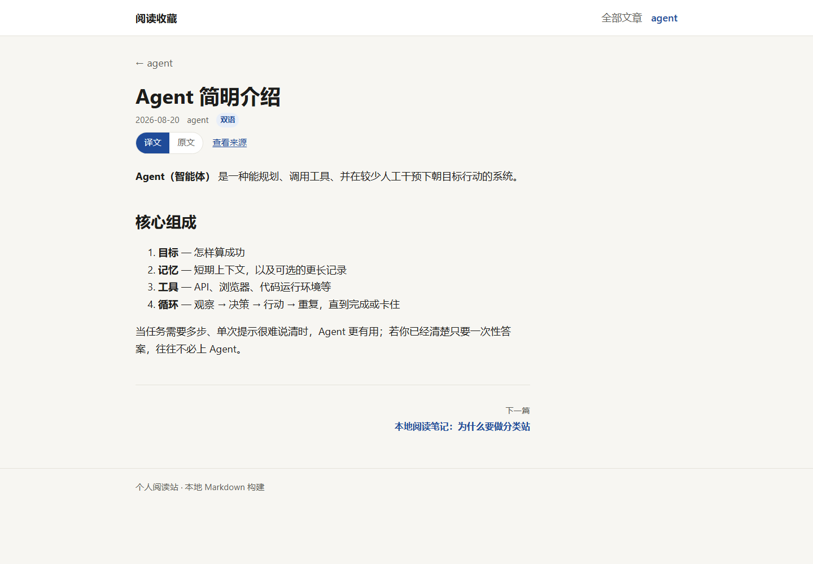
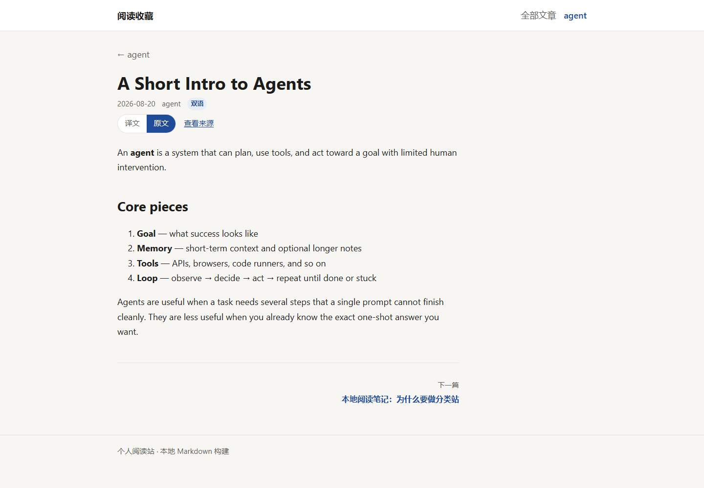

# 阅读收藏 · blog-essay

一个用 Markdown 维护内容、由 Astro 构建的个人文章分类阅读站。把想读的文章、中文译文和阅读笔记放进仓库，就能生成可部署到静态托管平台或云服务器的网站。

适合整理技术文章、积累个人知识库，也适合把外文原文和中文译文放在同一个页面中对照阅读。网站无需数据库或常驻应用服务，部署时只需发布构建生成的 `dist/` 文件。

## 目录

- [功能介绍](#功能介绍)
- [界面与使用示例](#界面与使用示例)
- [技术栈](#技术栈)
- [本地运行](#本地运行)
- [添加与维护文章](#添加与维护文章)
- [项目结构](#项目结构)
- [部署](#部署)
- [个性化配置](#个性化配置)
- [常见问题](#常见问题)

## 功能介绍

| 功能 | 说明 |
| --- | --- |
| 分类浏览 | 按内容目录自动生成分类、导航和文章数量，无需单独维护分类配置 |
| 最近更新 | 首页展示按文章 `date` 倒序排列的最近 6 篇文章 |
| 全部文章 | 集中浏览所有文章，双语原文与译文在列表中合并为一条 |
| 即时搜索 | 在浏览器中搜索标题、分类、摘要及正文，中英文内容都参与匹配 |
| 双语阅读 | 同一篇文章可切换中文译文和英文原文，同时更新页面标题 |
| 语言偏好 | 将选择保存在浏览器本地，下次打开双语文章时沿用；URL 参数优先 |
| 来源链接 | 配置 `source` 后，在阅读页显示“查看来源” |
| 文章导航 | 在同一分类内跳转上一篇、下一篇文章 |
| 响应式布局 | 支持桌面与手机阅读 |
| 静态输出 | 生成 HTML、CSS 和少量浏览器脚本，可直接交给静态文件服务器托管 |

文章和译文需要自行准备。项目不包含自动抓取、自动翻译、登录、评论或后台编辑系统。搜索与语言切换依赖浏览器 JavaScript；正文、分类和列表在构建时已生成。

## 界面与使用示例

以下图片均来自项目当前示例内容的本地运行页面。仓库包含 1 个分类、2 篇逻辑文章，其中 1 篇有中英文两个版本。

### 1. 首页：选择分类或最近更新的文章

打开首页后，点击分类卡片进入分类列表，也可以直接打开最近更新的文章。



### 2. 分类页：集中阅读同一主题

导航栏和首页分类卡片都能进入分类页。双语文章只计为一篇，并显示“双语”标记。



### 3. 搜索：按标题、摘要或正文筛选

点击“全部文章”，在搜索框输入关键词即可实时筛选。查询词保存在 URL 的 `q` 参数中，复制链接可保留查询条件。下图用“工具”匹配双语文章的中文正文。

```text
/articles/?q=工具
```



### 4. 双语阅读：切换译文与原文

打开双语文章，点击“译文”或“原文”切换显示内容。首次访问默认显示中文；之后优先使用 URL 中的有效 `lang` 参数，否则沿用本地语言偏好。

```text
/article/agent/intro-to-agents/?lang=zh
/article/agent/intro-to-agents/?lang=en
```

**中文译文**



**英文原文**



### 5. 手机端阅读

手机端沿用相同导航和文章内容，分类卡片与文章列表随屏幕宽度排列。


## 技术栈

| 技术 | 用途 |
| --- | --- |
| Astro 5 | 静态页面生成、路由与 Markdown 渲染 |
| TypeScript | 文章数据处理与浏览器交互 |
| Astro Content Collections + Zod | 加载文章并校验 frontmatter |
| 原生 CSS | 页面样式、文章排版与响应式布局 |
| npm | 依赖管理和开发命令 |

当前使用 Astro 默认的静态输出模式，不需要 SSR 适配器。

## 本地运行

### 环境要求

- 推荐 Node.js 22 LTS 或 24 LTS。
- npm 9.6.5 或更高版本。
- Git：从仓库克隆代码时使用；下载 ZIP 后也可以运行。

### 安装与启动

取得项目代码后，在项目根目录执行：

```bash
npm ci
npm run dev
```

默认访问地址：[http://localhost:4321](http://localhost:4321)。如果端口被占用，以终端输出的地址为准。

已有 `package-lock.json` 时，推荐 `npm ci` 按锁文件安装依赖；需要主动更新依赖时再使用 `npm install`。

### 常用命令

| 命令 | 作用 |
| --- | --- |
| `npm ci` | 按锁文件安装依赖 |
| `npm run dev` | 启动开发服务器，编辑内容后查看更新 |
| `npm run check` | 执行 Astro 与 TypeScript 检查 |
| `npm run build` | 校验内容并构建静态网站，输出到 `dist/` |
| `npm run preview` | 在本地预览已生成的构建结果 |

需要在同一局域网的手机上预览时：

```bash
npm run dev -- --host 0.0.0.0
```

让手机与电脑处于同一网络，访问 `http://<电脑局域网IP>:4321`，并确保系统防火墙允许该端口。

## 添加与维护文章

### 目录与命名

所有文章放在 `src/content/articles/<分类>/` 下：

```text
src/content/articles/
├── agent/
│   ├── intro-to-agents.zh.md
│   ├── intro-to-agents.en.md
│   └── local-notes.md
└── ai-tools/
    └── tool-notes.md
```

- 分类目录名必须与 frontmatter 的 `category` 一致。
- 分类目录名、文章文件名前缀和 `pair` 只允许小写字母、数字及单个连字符，例如 `ai-tools`、`tool-notes`。
- 双语文件可以使用 `.zh.md`、`.en.md` 后缀。文件名语言后缀是命名约定，实际语言由 `lang` 字段决定，二者应保持一致。
- 每篇文章直接放在一个分类目录中，不使用嵌套分类目录。
- 创建分类目录并添加文章后，导航、分类页和数量会自动生成；空目录不会生成分类。

### Frontmatter 字段

Markdown 文件顶部使用 `---` 包围 YAML 元数据：

| 字段 | 必填 | 说明 |
| --- | --- | --- |
| `title` | 是 | 文章标题，可用中文或英文 |
| `category` | 是 | 分类标识，必须与所在目录名一致 |
| `lang` | 是 | `zh` 或 `en` |
| `date` | 是 | 日期，建议使用 `YYYY-MM-DD`，决定列表排序 |
| `pair` | 否 | 同一分类中原文与译文共用的配对标识 |
| `source` | 否 | 完整来源 URL，如 `https://example.com/article` |
| `summary` | 否 | 列表摘要，也用于文章页 description |

“最近更新”依据 `date` 字段排序，不读取文件修改时间。更新文章后想让它排到前面，需要同步修改 `date`。完整双语文章优先使用中文版本的标题和日期作为列表信息。

### 添加单语文章

例如新建 `src/content/articles/ai-tools/tool-notes.md`：

```markdown
---
title: 我的工具使用笔记
category: ai-tools
lang: zh
date: 2026-10-12
summary: 记录工具配置和实际使用体验。
---

这里是正文，支持常规 Markdown 标题、列表、链接、图片和代码块。

## 使用记录

写下你的阅读笔记。
```

单语文章不需要 `pair`，也可以使用 `lang: en` 保存英文文章。上例生成路径为 `/article/ai-tools/tool-notes/`。

### 添加双语文章

在同一分类下添加两个 Markdown 文件，让它们共用一个 `pair`，分别设置 `lang: zh` 和 `lang: en`。

`src/content/articles/agent/my-article.zh.md`：

```markdown
---
title: 我的 Agent 文章
category: agent
lang: zh
pair: my-article
date: 2026-10-12
source: https://example.com/original
summary: 这篇文章的中文摘要。
---

这里放中文译文。
```

`src/content/articles/agent/my-article.en.md`：

```markdown
---
title: My Agent Article
category: agent
lang: en
pair: my-article
date: 2026-10-12
source: https://example.com/original
summary: A short English summary.
---

Place the original English article here.
```

两个版本齐全时，合并为 `/article/agent/my-article/`，显示语言切换按钮。只有一个版本时仍可阅读，路径采用该文件的文件名前缀，不显示双语切换。

同一分类、同一 `pair` 不能重复添加同一种语言，也不要让单语文章文件名前缀与其他文章路由冲突，否则构建会报错。

### 在文章里添加图片

建议把正文图片放进 `public/images/`，再使用站点根路径引用：

```text
public/images/agent-workflow.png
```

```markdown

```

`public/` 内的文件会原样复制到构建输出。README 的截图独立放在 `docs/images/`，使用仓库相对路径引用，便于在 GitHub 展示。

### 内容发布流程

1. 添加或修改 Markdown 及图片。
2. 执行 `npm run dev`，检查排版、来源链接和双语切换。
3. 执行 `npm run check` 和 `npm run build`。
4. 执行 `npm run preview`，检查构建后的页面。
5. 将新的 `dist/` 内容发布到托管平台或服务器。

## 项目结构

```text
blog-essay/
├── deploy/
│   └── nginx.example.conf       # Nginx 静态站点配置示例
├── docs/
│   ├── images/                  # README 实际页面截图
│   └── superpowers/             # 项目设计规格与实现计划
├── public/
│   └── favicon.svg              # 网站图标；正文静态图片也可放在此处
├── src/
│   ├── components/              # 导航、文章列表、语言切换组件
│   ├── content/articles/        # 按分类保存的 Markdown 内容
│   ├── content.config.ts        # 内容集合与字段校验
│   ├── layouts/BaseLayout.astro # 站点布局、标题与描述
│   ├── lib/articles.ts          # 文章加载、双语合并、排序与路由校验
│   ├── pages/                   # 首页、全部文章、分类、正文及 404 页面
│   └── styles/global.css        # 全局样式与阅读排版
├── astro.config.mjs             # Astro 配置与 SITE_URL 读取
├── package.json                 # 项目依赖与命令
├── package-lock.json            # npm 依赖锁文件
├── tsconfig.json                # TypeScript 配置
└── README.md
```

`node_modules/`、`.astro/` 和 `dist/` 是依赖或生成文件，已被 `.gitignore` 排除。

### 页面路由

| 路径 | 页面 |
| --- | --- |
| `/` | 分类与最近更新 |
| `/articles/` | 全部文章与搜索 |
| `/articles/?q=关键词` | 带查询条件的文章列表 |
| `/category/<category>/` | 指定分类的文章列表 |
| `/article/<category>/<slug>/` | 正文 |
| `/article/<category>/<slug>/?lang=en` | 双语文章的英文版本 |
| `/404.html` | 构建生成的 404 页面，需由托管平台配置错误页 |

## 部署

### 1. 生产构建

在项目根目录设置真实站点地址，再构建：

**macOS / Linux**

```bash
npm ci
npm run check
SITE_URL=https://read.example.com npm run build
```

**Windows PowerShell**

```powershell
npm ci
npm run check
$env:SITE_URL = 'https://read.example.com'
npm run build
```

将 `https://read.example.com` 替换为你的站点地址。不设置 `SITE_URL` 也能进行本地构建；设置后会传给 Astro 的 `site` 配置。

当前配置通过 `process.env.SITE_URL` 读取值。请使用构建命令的环境变量或托管平台的环境变量设置，不依赖在 `.env` 中写入该字段来生效。

构建结果位于 `dist/`。生产环境发布这个目录的**内容**，无需上传 `node_modules/`，也无需运行 `npm run dev` 或 `npm run preview`。

### 2. 静态托管平台

可部署到支持静态网站的 Cloudflare Pages、Netlify、Vercel 等平台。日后关联 GitHub 仓库时，可使用以下设置；本仓库目前未附带自动部署工作流。

| 配置项 | 值 |
| --- | --- |
| 项目根目录 | 仓库根目录 |
| 框架 | Astro，或静态网站 |
| 安装命令 | `npm ci`（平台单独提供此设置时填写） |
| 构建命令 | `npm run build` |
| 输出目录 | `dist` |
| Node.js | 22 或 24 |
| 环境变量 | `SITE_URL=https://你的域名` |

使用平台分配的域名验证页面后，再按平台指引绑定自定义域名。将最终站点地址写入 `SITE_URL` 并重新构建。

**GitHub 仓库与 GitHub Pages 的区别：**代码可以直接放进 GitHub 仓库，但当前导航和静态资源使用 `/articles/`、`/favicon.svg` 这样的根路径，适合部署在域名根目录。若使用 `https://<用户名>.github.io/<仓库名>/` 这种项目子路径，需要额外配置 Astro `base` 并同步修改页面、资源和文章图片的路径；仅设置 `SITE_URL` 无法完成适配。使用 GitHub 用户站点根路径或自定义域名时无需这项子路径改造，但仍需配置构建发布流程。

### 3. 云服务器 + Nginx

以下示例适用于 Ubuntu / Debian 服务器，并假设已经安装 Nginx、可以通过 SSH 登录。命令中的域名、用户、主机及目录请替换为实际值。

在服务器上准备网站目录：

```bash
sudo mkdir -p /var/www/blog-essay
sudo chown "$USER":"$(id -gn)" /var/www/blog-essay
```

在本机构建后上传 `dist/` 的内容。例如，在 macOS / Linux 本地使用：

```bash
rsync -av dist/ deploy-user@your-server:/var/www/blog-essay/
```

Windows PowerShell 安装 OpenSSH 客户端后，可以使用：

```powershell
scp -r ./dist/* deploy-user@your-server:/var/www/blog-essay/
```

上传用户需要对目标目录有写入权限。上述同步方式不会删除服务器旧文件；如果删除或重命名了文章，也需清理服务器上对应的旧页面，或采用整目录版本替换。

将仓库中的 [`deploy/nginx.example.conf`](deploy/nginx.example.conf) 复制到服务器的 `/etc/nginx/sites-available/blog-essay`，修改以下配置：

```nginx
server_name read.example.com;
root /var/www/blog-essay;
```

示例已包含静态文件查找、资源缓存和 `404.html` 错误页设置。在服务器启用配置并检查：

```bash
sudo ln -s /etc/nginx/sites-available/blog-essay /etc/nginx/sites-enabled/blog-essay
sudo nginx -t
sudo systemctl reload nginx
```

软链接只在首次启用时创建。将域名 DNS 指向服务器，并开放 HTTP / HTTPS 端口。需要 HTTPS 时，可在 Ubuntu / Debian 安装 Certbot 并申请证书：

```bash
sudo apt update
sudo apt install certbot python3-certbot-nginx
sudo certbot --nginx -d read.example.com
```

申请证书前，域名应已解析到服务器，且 HTTP 可访问。此后更新内容只需重新构建并发布静态文件。

### 4. 部署后检查

- 首页、分类页和文章页可以直接访问，刷新不会返回 404。
- “全部文章”能搜索到正文关键词，刷新保留 `q` 参数。
- 双语按钮能切换正文，`?lang=en` 能直接打开英文版本。
- 图片、图标和样式正常，手机端可以阅读。
- 不存在的路径返回 404，并显示站点错误页。

## 个性化配置

| 想修改的内容 | 位置 |
| --- | --- |
| 首页标题、介绍文字与最近更新数量 | `src/pages/index.astro` |
| 导航栏站点名称 | `src/components/Header.astro` |
| 浏览器标题后缀与页脚 | `src/layouts/BaseLayout.astro` |
| 双语切换后的浏览器标题后缀 | `src/pages/article/[category]/[slug].astro` |
| 配色、字体、布局与文章样式 | `src/styles/global.css` |
| 网站图标 | `public/favicon.svg` |
| 分类名称 | 文章目录名及每篇文章的 `category` |
| 生产站点地址 | 构建环境中的 `SITE_URL` |

修改站点名称时，首页、导航、基础布局和双语切换脚本中的“阅读收藏”应一起更新。

## 常见问题

**新增文章后线上没有变化？**

生产站点是静态文件。修改 Markdown 后要重新执行 `npm run build`，再发布新的构建结果；必要时刷新托管平台或浏览器缓存。

**构建提示 `Category mismatch` 或命名不合法？**

检查 `category` 是否与目录名一致，并确认目录名、文件名前缀和 `pair` 使用小写字母、数字及单个连字符。

**双语文章没有显示切换按钮？**

确认两个文件在同一分类下、使用相同 `pair`，并且一个是 `lang: zh`、另一个是 `lang: en`。只有单个版本不会显示切换按钮。

**提示重复语言或重复文章路由？**

检查同一 `pair` 是否存在多个中文或英文版本，以及单语文章文件名前缀是否与其他逻辑文章的 slug 相同。

**为什么新打开的双语文章直接显示英文？**

网站记住了上次选择。点击“译文”，或使用带 `?lang=zh` 的链接覆盖本地偏好。

**搜索如何匹配？**

搜索会去掉查询词首尾空白，忽略大小写，对合并后的标题、分类、摘要和 Markdown 正文做字符串包含匹配。目前没有分词、模糊匹配或搜索结果高亮；输入多个词时会作为一个整体匹配。

**图片不显示或子页面刷新 404？**

确认图片在 `public/` 中，引用路径不含 `public` 前缀；部署目录必须指向 `dist/` 的内容，服务器需支持目录下的 `index.html`。如果站点部署在仓库名子路径下，还需要处理前文所述的 `base` 和根路径链接。

**可以直接双击 `dist/index.html` 预览吗？**

使用 `npm run preview` 通过 HTTP 预览。直接以 `file://` 打开无法正确模拟站点根路径和页面跳转。

## 设计资料

- [阅读站设计规格](docs/superpowers/specs/2026-08-25-reading-collection-design.md)
- [实现计划](docs/superpowers/plans/2026-08-26-reading-collection.md)
